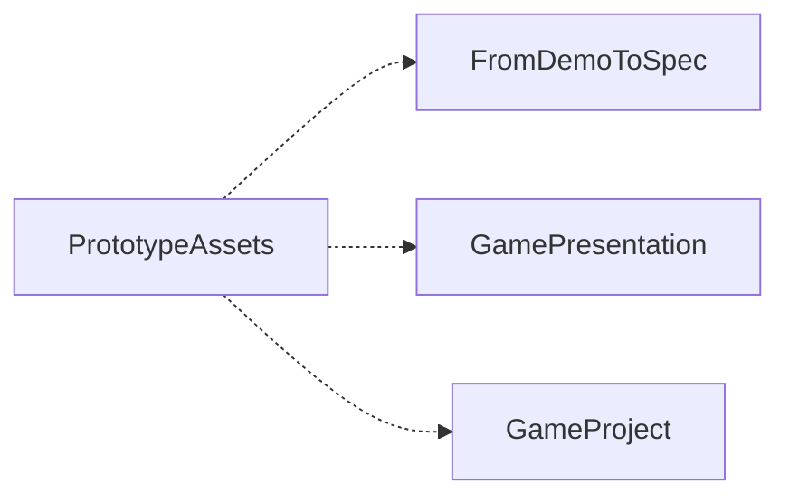

# PrototypeAssets


[English](README.en.md)

## 独立使用与相关模块

本仓是 PrototypeAssets 的独立发布内容。按下方业务入口开始，实际环境要求见模块文档与 [module.json](module.json)。AWS 与 meta 可以按需要提供跨模块协作和宿主治理，当前用户授权与已有宿主规则保持权威。

模块相关能力、数据交接和安装审阅见 [协作说明](docs/module-cooperation.md)。只读取本次任务需要的入口，用户项目、账号、资料和工具运行环境按各业务文档放在包外。

```text
python .module/module_manager.py verify
python .module/module_manager.py related
python .module/module_manager.py audit --target <workspace> --modules <related-id>
python .module/module_manager.py fetch --target <workspace> --modules <related-id> --apply
```

先审阅已有同类模块、输入输出和数据归属，再按实际需要执行获取。已有同版本模块通过身份与库存核对后复用，具体业务接线沿协作说明决定。

<!-- module-panorama:start -->


虚线表示可选协作。具体用途与接口见 module.json 和协作说明。 / Dashed edges indicate optional cooperation. See module.json and the cooperation guide.
<!-- module-panorama:end -->

来源、许可和哈希可追溯的精选素材与受控复制工具。本版包含 119 项现有许可收据明确允许公开分发的资产，基础目录与 Godot 增量分别保留；不含下载缓存、完整原包、限制素材和私人项目。

不依赖 meta、GameAnalysisDecision、GamePresentation 或 FromDemoToSpec。Node.js 22+，从包目录查看、核验、按 ID 导出：

```text
node scripts/assets.mjs list
node scripts/assets.mjs verify
node scripts/assets.mjs export --ids <asset-id> --target <new-bundle>
node scripts/assets.mjs export --ids <asset-id> --target <new-bundle> --apply
node --test tests/assets.test.mjs tests/publish-directory.test.mjs
```

导出目标须为空或已属于同一份完全一致导出，默认不写入。素材、实际许可、来源元数据与哈希一起复制，游戏运行不依赖本仓。Godot 项目的更新/回滚可选用 GamePresentation；FromDemoToSpec 可消费导出的基础 2D 素材。审核内容不能替代真实解码、引擎显示、听感或具体用途认可。

外部素材按每项 licenses 中的原许可使用；页面快照仅作审计证据，导出默认只携带许可正文，不将网页快照当素材。新增来源需重新审核，不从已下载推断分发权。运行脚本不联网、不执行素材包程序，未自动下载更多素材。

Windows 目录落盘遇到 EPERM/EACCES/EBUSY 时，最多追加 6 次短暂重试，总等待不超过 1.575 秒；目标在等待中出现、权限持续不足或其他错误仍明确失败，不覆盖另一写入者。
